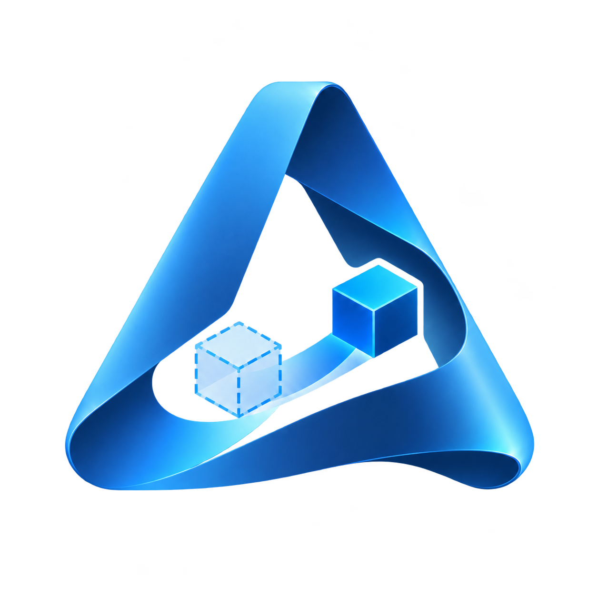
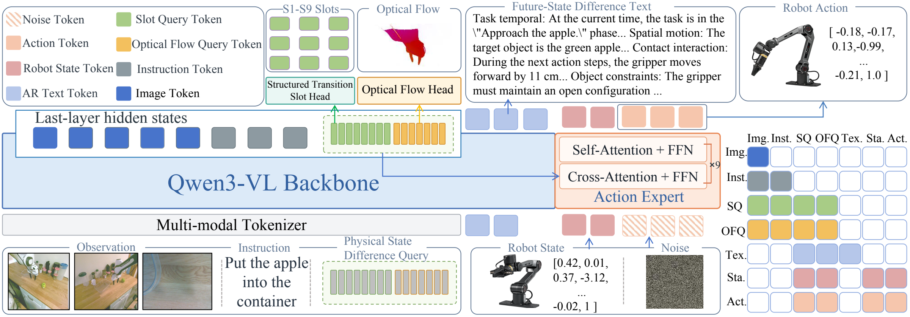

<div align="center">
  <h1>&nbsp; VLA-Δ</h1>
  <h3>Learning Physical State Transition for Vision-Language-Action Models</h3>
  <p>
    <a href="https://arxiv.org/abs/2610.21306" title="arXiv"></a>
    <a href="https://zju-omniai.github.io/VLA-Delta/" title="Project page"></a>
    <a href="https://huggingface.co/t0rn0d0" title="Hugging Face"></a>
    <a href="https://modelscope.cn/profile/t0rn0d0" title="ModelScope"></a>
  </p>
  <p>
    <a href="#environment-setup"></a>
    <a href="LICENSE"></a>
  </p>
  <a id="resource-links"></a>
</div>

## 🎬 Introduction Video

https://github.com/user-attachments/assets/764a646e-3b67-4933-b7dc-e46640f3909e

[Open video directly](https://zju-omniai.github.io/VLA-Delta/Video/introduction.mp4)

## 🧭 Overview

**VLA-Δ** is a vision-language-action model for robotic manipulation. It uses physical state difference queries to learn action-relevant representations through supervision from future-state difference text, structured slots, and optical flow, and generates continuous actions with a Flow Matching Action Expert.

This repository provides three-stage pretraining based on [ZR-0](https://github.com/RUCKBReasoning/ZR-0), LIBERO / RoboTwin fine-tuning from VLA-Δ base, and simulation evaluation on both benchmarks.

[](docs/assets/images/2-method.pdf)

## 📊 Results

The following results are reported in the paper. Success rates are expressed as percentages.

### LIBERO

| Methods | VLM Size | Spatial | Object | Goal | Long | Average |
| --- | --- | --- | --- | --- | --- | --- |
| TraceVLA | 7B | 84.6 | 85.2 | 75.1 | 54.1 | 74.8 |
| openVLA | 7B | 84.7 | 88.4 | 79.2 | 53.7 | 76.5 |
| SpatialVLA | 4B | 88.2 | 89.9 | 78.6 | 55.5 | 78.1 |
| WorldVLA | 7B | 87.6 | 96.2 | 83.4 | 60.0 | 81.8 |
| CoT-VLA | 7B | 87.5 | 91.6 | 87.6 | 69.0 | 83.9 |
| ThinkAct | 7B | 88.3 | 91.4 | 87.1 | 70.9 | 84.4 |
| SmolVLA | 500M | 93.0 | 94.0 | 91.0 | 77.0 | 88.8 |
| DreamVLA | 345M | 97.5 | 94.0 | 89.5 | 89.5 | 92.6 |
| π₀ | 3B | 96.8 | 98.8 | 95.8 | 85.2 | 94.2 |
| UniVLA | 7B | 95.4 | 98.8 | 93.6 | 94.0 | 95.5 |
| π₀.₅ | 3B | **98.8** | 98.2 | 98.0 | 92.4 | 96.9 |
| GR00T-N1.7 | 2B | 97.7 | 97.5 | <ins>98.5</ins> | 94.4 | 97.0 |
| openVLA-OFT | 7B | 97.6 | 98.4 | 97.9 | 94.6 | 97.1 |
| VLA-Adapter | 0.5B | <ins>97.8</ins> | 99.2 | 97.2 | <ins>95.0</ins> | 97.3 |
| ZR-0 | 2B | 97.4 | <ins>99.4</ins> | 97.8 | **96.4** | <ins>97.8</ins> |
| **VLA-Δ** | **2B** | **98.8** | **99.8** | **98.6** | **96.4** | **98.4** |

### RoboTwin 2.0

| Method | Clean | Random |
| --- | --- | --- |
| X-VLA | 72.88 | 72.84 |
| π₀ | 65.92 | 58.4 |
| π₀.₅ | 82.74 | 76.76 |
| Motus | 88.52 | 87.02 |
| ZR-0 | 88.70 | 87.98 |
| **VLA-Δ** | **90.06** | **89.74** |

## Quick Start

Run all commands from the repository root. Replace custom paths in the examples with the actual paths on your machine.

<a id="environment-setup"></a>

### 🛠️ Environment Setup

Model training and inference use Linux, Python 3.10, and a CUDA GPU. First, create the model environment:

```bash
conda create -n vla-delta -c conda-forge python=3.10 pip libgl libegl ffmpeg -y
conda activate vla-delta
export PYTHONNOUSERSITE=1
export LD_LIBRARY_PATH="$CONDA_PREFIX/lib${LD_LIBRARY_PATH:+:$LD_LIBRARY_PATH}"
python -m pip install torch==2.6.0 torchvision==0.21.0 --index-url https://download.pytorch.org/whl/cu124
python -m pip install -r requirements/train.txt
```

Install the LIBERO and RoboTwin simulation dependencies in separate environments. See the [LIBERO evaluation guide](evaluation/libero/README.md) and [RoboTwin evaluation guide](evaluation/robotwin/README.md) for installation instructions.

### 📦 Data and Checkpoints

| Resource | Type | Download |
| --- | --- | --- |
| vla-delta-base | Model | [VLA-Delta-base](https://huggingface.co/t0rn0d0/VLA-Delta-base) |
| vla-delta-libero | Model | [VLA-Delta-libero](https://huggingface.co/t0rn0d0/VLA-Delta-libero) |
| vla-delta-robotwin | Model | [VLA-Delta-robotwin](https://huggingface.co/t0rn0d0/VLA-Delta-robotwin) |
| libero | Dataset | [HuggingFaceVLA/libero](https://huggingface.co/datasets/HuggingFaceVLA/libero) |
| robotwin | Dataset | [TianxingChen/RoboTwin2.0](https://huggingface.co/datasets/TianxingChen/RoboTwin2.0) |
| zr0-base | Model | [seeklhy/ZR-0](https://www.modelscope.cn/models/seeklhy/ZR-0) |

The default dataset directories are `data/libero` and `data/robotwin`. To use other locations, update `dataset_path` for the corresponding entry in [dataset2feature.yaml](dataset2feature.yaml). Relative paths in YAML are resolved against the directory containing the file that declares the field.

<a id="evaluation"></a>

### 🧪 Evaluation

Evaluation connects the model server and simulation client over WebSocket, with each process running in its own environment. The following **LIBERO evaluation** example assumes that you have completed the simulation environment setup and path initialization described in the [detailed guide](evaluation/libero/README.md).

Start the model server in the first terminal:

```bash
conda activate vla-delta
export PYTHONNOUSERSITE=1
export LD_LIBRARY_PATH="$CONDA_PREFIX/lib${LD_LIBRARY_PATH:+:$LD_LIBRARY_PATH}"
export VLA_EVAL_CHECKPOINT="$PWD/checkpoints/VLA-Delta-libero"
python server.py --config configs/eval/libero_server.yaml
```

Keep the server running and start evaluation in a second terminal:

```bash
conda activate vla-libero
export PYTHONNOUSERSITE=1
export LD_LIBRARY_PATH="$CONDA_PREFIX/lib${LD_LIBRARY_PATH:+:$LD_LIBRARY_PATH}"
export LIBERO_CONFIG_PATH="$PWD/data/libero-config"
export MUJOCO_GL=egl
export PYOPENGL_PLATFORM=egl
python scripts/evaluate.py --config configs/eval/libero.yaml --execute
```

For complete installation instructions, model configuration, and evaluation parameters, see:

- [LIBERO Evaluation Guide](evaluation/libero/README.md)
- [RoboTwin Evaluation Guide](evaluation/robotwin/README.md)

<a id="fine-tuning"></a>

### Fine-Tuning VLA-Δ

Initialize fine-tuning from `VLA-Delta-base` or your own base model. LIBERO and RoboTwin share the same training entry point; the configuration file selects the dataset entry and action prediction horizon.

```bash
conda activate vla-delta
export PYTHONNOUSERSITE=1
export LD_LIBRARY_PATH="$CONDA_PREFIX/lib${LD_LIBRARY_PATH:+:$LD_LIBRARY_PATH}"
export VLA_PRETRAIN_CHECKPOINT="$PWD/checkpoints/VLA-Delta-base"
export VLA_OUTPUT_ROOT="$PWD/outputs"
```

**LIBERO:**

```bash
python scripts/train.py --config configs/finetune/libero.yaml --execute
```

**RoboTwin ALOHA AgileX:**

```bash
python scripts/train.py --config configs/finetune/robotwin.yaml --execute
```

Append arguments such as `--epochs`, `--max_train_steps`, and `--peak_learning_rate` to override the YAML settings. To use a private dataset registry, append `--dataset_registry /absolute/path/to/dataset2feature.local.yaml`. Replace `--execute` with `--dry-run` to check the arguments and launch command without starting training.

### 4.5 Three-Stage Pretraining

The three stages successively learn future-state difference text, auxiliary slot / optical flow representations, and joint action prediction.

Specify the actual paths for each dataset entry in [dataset2feature.yaml](dataset2feature.yaml):

```bash
conda activate vla-delta
export PYTHONNOUSERSITE=1
export LD_LIBRARY_PATH="$CONDA_PREFIX/lib${LD_LIBRARY_PATH:+:$LD_LIBRARY_PATH}"
export VLA_BASE_MODEL="$PWD/checkpoints/ZR-0"
export VLA_PREPARED_ROOT="$PWD/data/prepared"
export VLA_OUTPUT_ROOT="$PWD/outputs/pretrain"

python scripts/prepare_pretraining.py --config configs/pretrain/prepare.yaml

# Stage 1: Learn future-state difference text
python scripts/train.py --config configs/pretrain/stage1_ar.yaml --execute

# Stage 2: Initialize auxiliary slot / optical flow learning from Stage 1 weights
export VLA_STAGE1_CHECKPOINT="$VLA_OUTPUT_ROOT/stage1_ar/model-final"
python scripts/train.py --config configs/pretrain/stage2_aux.yaml --execute

# Stage 3: Initialize joint training from Stage 2 weights
export VLA_STAGE2_CHECKPOINT="$VLA_OUTPUT_ROOT/stage2_aux/model-final"
python scripts/train.py --config configs/pretrain/stage3_joint.yaml --execute
```

## 5. 📝 Citation

If you find this work useful, please cite:

```bibtex
@misc{lu2026vladeltalearningphysicalstate,
      title={VLA-$\Delta$: Learning Physical State Transition for Vision-Language-Action Models},
      author={Qi Lu and Jiarun Li and Ce Zhang and Miao Pan and Yi Pan and Xu Wang and Wenqi Zhang and Xuhong Zhang},
      year={2026},
      eprint={2610.21306},
      archivePrefix={arXiv},
      primaryClass={cs.CV},
      url={https://arxiv.org/abs/2610.21306},
}
```

## 6. 🙏 Acknowledgements

This repository builds on [ZR-0](https://github.com/RUCKBReasoning/ZR-0), [LeRobot](https://github.com/huggingface/lerobot), and the Hugging Face ecosystem. It uses [Qwen3-VL](https://github.com/QwenLM/Qwen3-VL) as its vision-language backbone and [LIBERO](https://github.com/Lifelong-Robot-Learning/LIBERO) and [RoboTwin](https://github.com/RoboTwin-Platform/RoboTwin) for evaluation. We thank [Isaac-GR00T](https://github.com/NVIDIA/Isaac-GR00T) and other open-source projects for their contributions to robotics foundation model research. When using this repository, please also follow the terms of and cite the relevant upstream projects. See [THIRD_PARTY_NOTICES.md](THIRD_PARTY_NOTICES.md) for third-party attribution.
